<div align="center">

  <a href="https://github.com/gendonholaholo/MatchTone">
    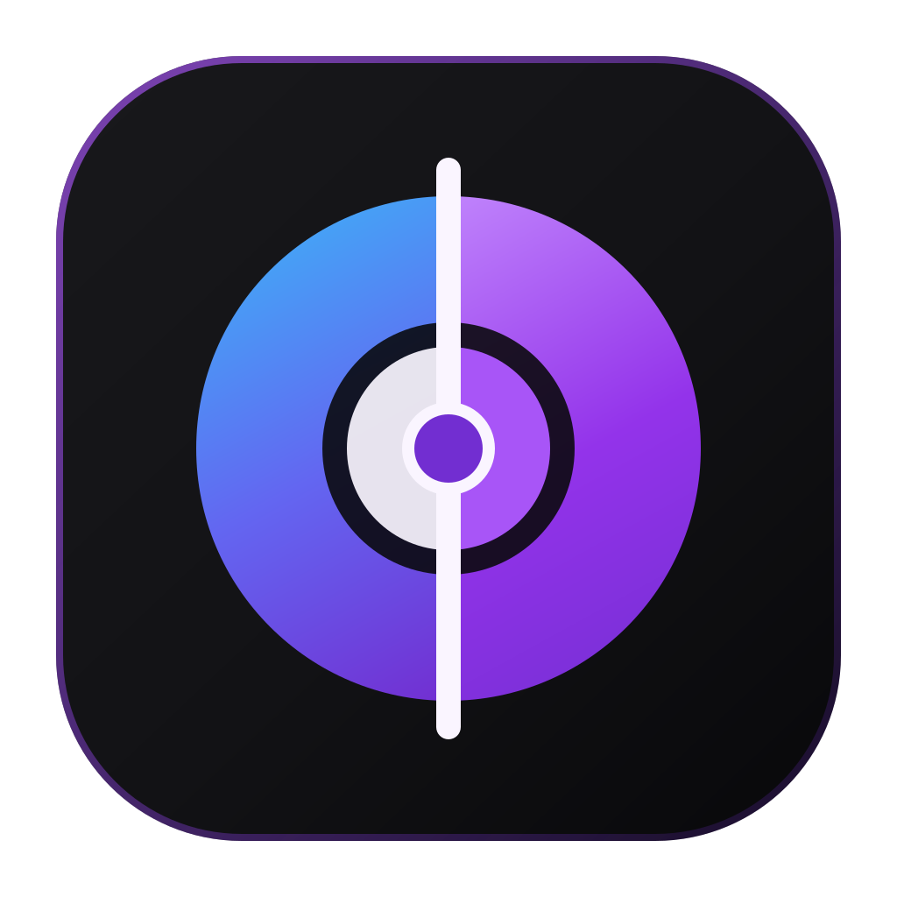
  </a>

  <h1>MatchTone</h1>

  <p>
    <strong>Automatic photo color matching for macOS — transfer the mood, warmth, and color palette of any reference photo in one click.</strong>
  </p>

  <p>
    <a href="https://github.com/gendonholaholo/MatchTone/releases"></a>
    <a href="https://github.com/gendonholaholo/MatchTone/releases"></a>
    <a href="LICENSE"></a>
    <a href="https://github.com/hahnec/color-matcher"></a>
  </p>

  <p>
    <a href="#real-photo-results">Real Results</a> ·
    <a href="#inside-the-app">Inside the App</a> ·
    <a href="#features">Features</a> ·
    <a href="#download--quick-start">Download</a>
  </p>

</div>

<br />

<div align="center">
  <a href="docs/media/matchtone-demo.mp4">
    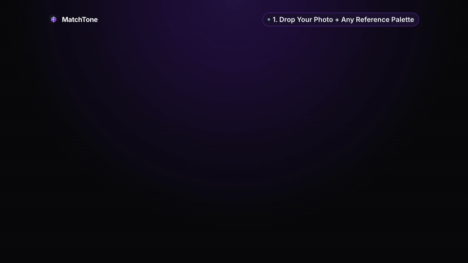
  </a>
  <p><sub>Click the preview above to watch the full 1080p simulation video (<code>docs/media/matchtone-demo.mp4</code>).</sub></p>
</div>

---

## Why MatchTone?

[`color-matcher`](https://github.com/hahnec/color-matcher) is a brilliant scientific color-transfer engine, but running command-line flags just to match two photos breaks your creative flow.

**MatchTone** wraps `color-matcher` in a fast, minimalist desktop studio inspired by [Upscayl](https://github.com/upscayl/upscayl). Drop your photo, drop a color reference, scrub the live **Before / After** split slider, and dial in the exact blend strength—100% offline on your machine.

---

## Real Photo Results

Every example below was processed directly inside **MatchTone** (`HM-MVGD-HM` method at `100%` strength) using real-world photographs.

|                                          Source Photo (Before)                                           |                                       Color Reference (Target Mood)                                       |                                          MatchTone Result (After)                                          |
| :------------------------------------------------------------------------------------------------------: | :-------------------------------------------------------------------------------------------------------: | :--------------------------------------------------------------------------------------------------------: |
|    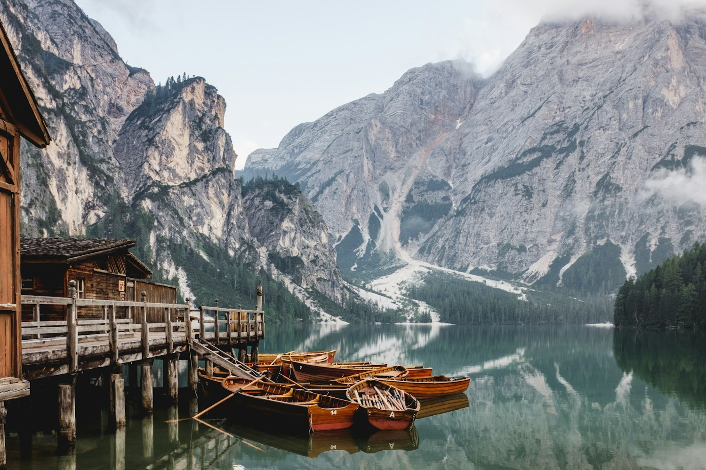     | 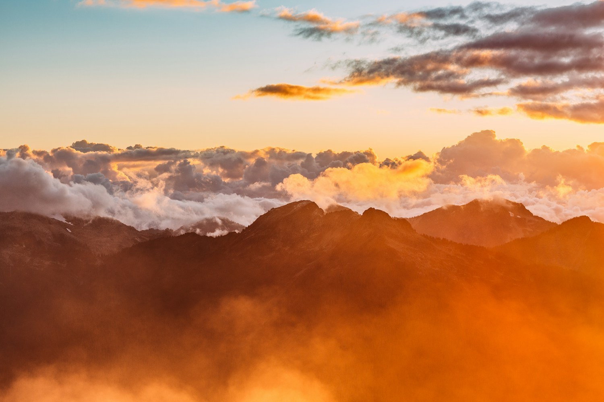 |    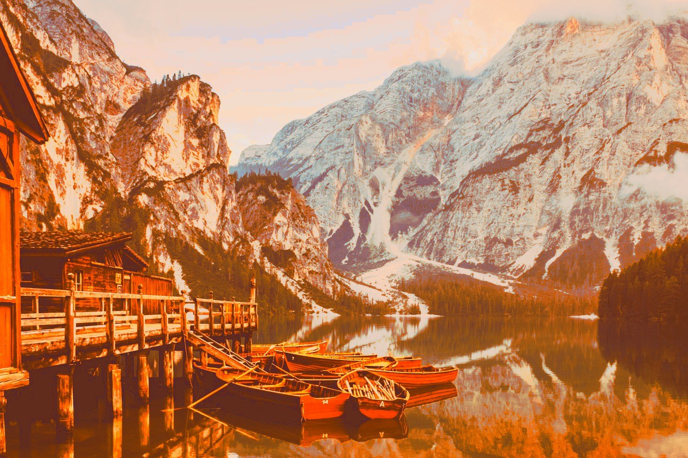    |
|                    **Daylight Alpine Lake**<br/><sub>Cool midday mountain light</sub>                    |                    **Golden Hour Sunset**<br/><sub>Warm amber & magenta horizon</sub>                     |                **Golden Hour Grade**<br/><sub>Matched warmth with natural water & sky</sub>                |
| 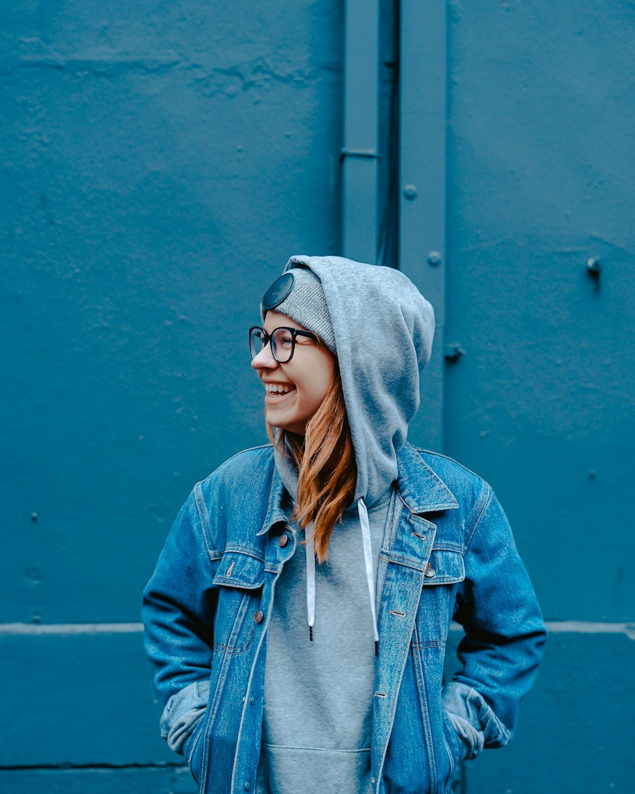 |     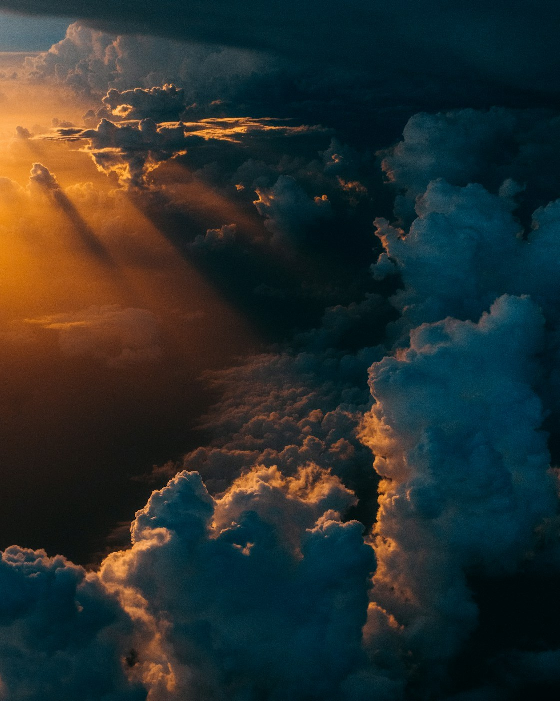     | 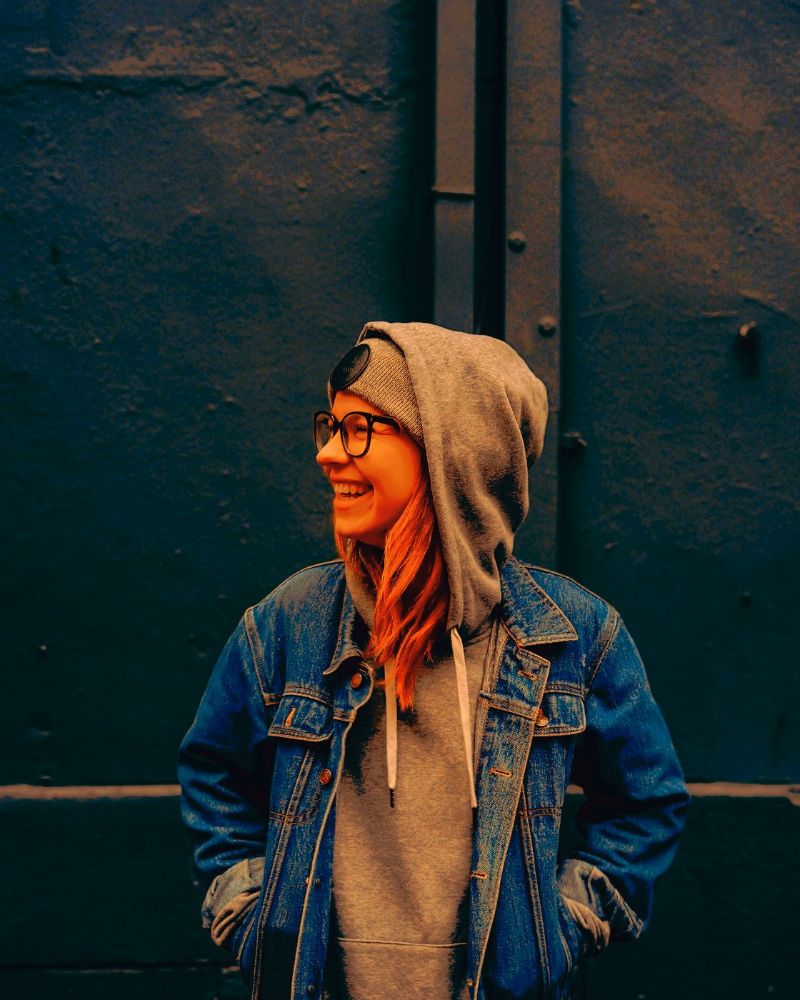 |
|               **Natural Daylight Portrait**<br/><sub>Neutral outdoor skin & foliage</sub>                |                    **Teal & Amber Cinema**<br/><sub>Moody tungsten-teal contrast</sub>                    |            **Cinematic Portrait Grade**<br/><sub>Balanced skin highlights & deep shadows</sub>             |

---

## Inside the App

<table>
  <tr>
    <td width="50%" align="center">
      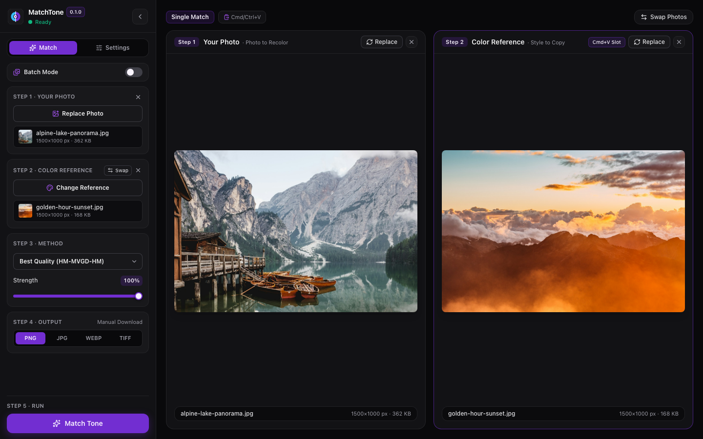
      <br />
      <strong>1. Drop Your Photo & Reference</strong>
      <br />
      <sub>Side-by-side cards show resolution, format badge, and instant Swap / Clear controls.</sub>
    </td>
    <td width="50%" align="center">
      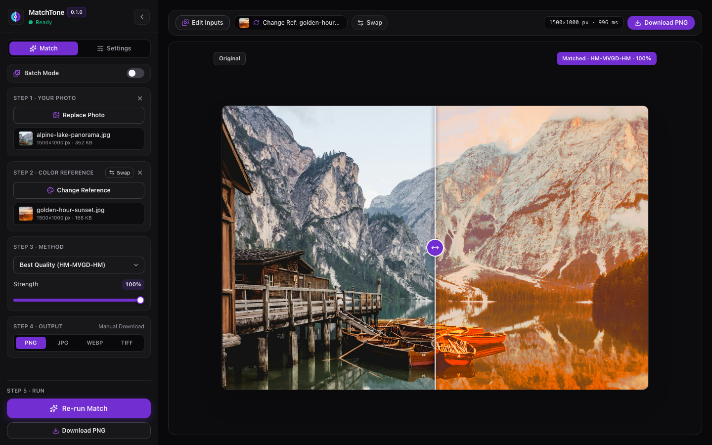
      <br />
      <strong>2. Scrub the Live Split Comparison</strong>
      <br />
      <sub>Drag the <code>&lt;&gt;</code> handle anywhere across the canvas to compare Original vs Matched pixel-for-pixel.</sub>
    </td>
  </tr>
  <tr>
    <td width="50%" align="center">
      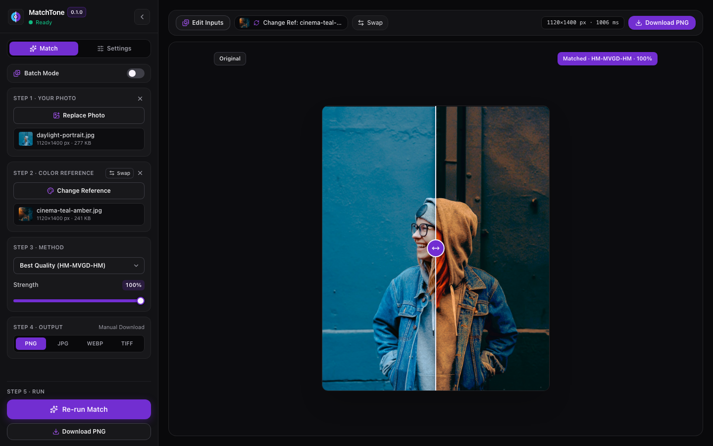
      <br />
      <strong>3. Fine-Tune Method & Blend Strength</strong>
      <br />
      <sub>Switch between 6 transfer algorithms and adjust the 0–100% Strength slider with live auto-update.</sub>
    </td>
    <td width="50%" align="center">
      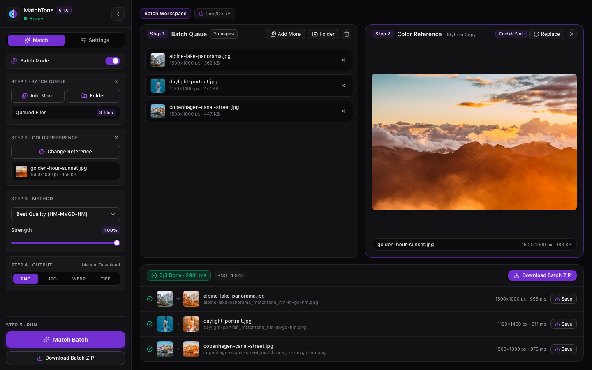
      <br />
      <strong>4. Grade an Entire Shoot in Batch Mode</strong>
      <br />
      <sub>Apply one reference look to dozens of photos with visual Before → Matched cards and one-click ZIP export.</sub>
    </td>
  </tr>
</table>

---

## Features

- **One-Click Reference Color Grading** — Transfer the color distribution of any reference photo, film frame, or painting onto your image without manual curves or LUT hunting.
- **6 Official Transfer Methods** — Switch anytime between **Best Quality** (`HM-MVGD-HM`), **Balanced** (`HM-MKL-HM`), **Smooth Linear** (`MKL`), **Rich Gaussian** (`MVGD`), **Natural Contrast** (`Reinhard`), and **Classic Histogram** (`HM`).
- **Live 0–100% Strength Slider** — Dial back strong looks effortlessly; adjusting the **Strength** slider blends the graded result with your original photo automatically.
- **Interactive Before / After Split Canvas** — Full-bleed dark studio viewport with pointer-captured drag handle, keyboard arrow scrubbing, and automatic aspect-ratio scaling.
- **Batch Mode with Visual Previews** — Queue multiple photos at once, inspect side-by-side `Before → Matched` thumbnails for every item, and save individual files or a single `.zip` archive.
- **Broad Format & Alpha Support** — Load `JPG`, `PNG`, `WEBP`, `TIFF`, and `BMP` up to 50 MB each; export as `PNG`, `JPG`, `WEBP`, or `TIFF` with full transparency (`RGBA`) preservation.
- **100% Local & Private** — Runs a self-contained native engine on your Mac. Zero cloud uploads, zero accounts, zero watermarks, and built-in runtime telemetry (`RSS MB` & latency breakdown).

---

## Download & Quick Start

1. Download **`MatchTone.app`** from [Releases](https://github.com/gendonholaholo/MatchTone/releases) (or copy it to `/Applications/MatchTone.app`).
2. Launch **MatchTone** and drop **Your Photo** on the left card and a **Color Reference** on the right card.
3. Click **Match Tone**, drag the center split handle to inspect the grade, and click **Export** to save your result.

<details>
<summary><strong>Build from Source (Developers)</strong></summary>

<br />

MatchTone uses **Electron + React + TypeScript** for the desktop UI and a standalone **Python 3.12 (`color-matcher`)** sidecar packaged via PyInstaller.

```bash
# 1. Clone the repository
git clone https://github.com/gendonholaholo/MatchTone.git
cd MatchTone

# 2. Set up the local Python 3.12 color-engine sidecar
cd color-engine
uv venv --python 3.12 .venv
.venv/bin/pip install -e ".[dev]"
.venv/bin/pyinstaller --noconfirm --clean --onedir --name color-engine \
  --exclude-module matplotlib --exclude-module tkinter \
  --copy-metadata color-engine --copy-metadata imageio --copy-metadata color-matcher \
  --collect-submodules uvicorn --collect-submodules color_matcher \
  src/color_engine/__main__.py
cd ..

# 3. Install UI dependencies & run in development mode
bun install
bun run dev

# 4. Package native macOS application bundle (release/mac-arm64/MatchTone.app)
bun run pack
```

</details>

---

## Credits & License

- Color transfer engine powered by [**hahnec/color-matcher**](https://github.com/hahnec/color-matcher) by [Christopher Hahne](https://github.com/hahnec).
- Desktop studio layout inspired by [**Upscayl**](https://github.com/upscayl/upscayl).
- Sample photographs from [Unsplash](https://unsplash.com) (Lago di Braies alpine landscape & portrait photography).
- Released under the [**GNU General Public License v3.0 (GPL-3.0-or-later)**](LICENSE).
